<div align="center">

# ProfileTTY

**Tu identidad, en caracteres.**

Genera tarjetas de perfil para GitHub con estética de terminal a partir de un archivo ASCII local y una pequeña configuración JSON.

Node.js 24.12+ · TypeScript · Sin dependencias de ejecución · Sin API alojada

[English](README.md) · [Português](README.pt.md) · [Español](README.es.md)

</div>

<picture>
  <source media="(prefers-color-scheme: dark)" srcset="docs/profile-dark.svg">
  
</picture>

## Un perfil que puedes guardar en tu repositorio

ProfileTTY genera SVG estáticos. Tu README no necesita servidor, clave de API, servicio de analítica ni generador externo de imágenes. Los valores se escapan para XML, los textos largos se dividen en líneas y la altura se adapta al contenido.

- Temas claro y oscuro.
- Diseño horizontal, al estilo terminal.
- Arte ASCII centrado que conserva los espacios.
- Configuración JSON local con campos agrupados.
- Títulos y descripciones accesibles en los SVG.

## Pruébalo

Usa **Node.js 26 LTS** para desarrollar. También es compatible con **Node.js 24.12 o posterior**. Se utiliza la ejecución nativa de TypeScript; el generador no compila ni comprueba tipos con `tsc`.

```sh
git clone https://github.com/KaduKessler/profiletty.git
cd profiletty
npm test
npm run build
```

No necesitas ejecutar `npm install`.

Los archivos se guardan en `dist/`:

```text
dist/
├── README.md
├── profile-dark.svg
└── profile-light.svg
```

## Personalízalo

Copia `examples/profile.json` y sustituye los datos. En `ascii`, indica tu archivo de texto; la ruta se resuelve respecto al archivo JSON. Las claves del JSON siguen en inglés; puedes traducir el contenido de los campos.

```json
{
  "heading": "yourname@github",
  "ascii": "logo.txt",
  "groups": [
    {
      "name": "Work",
      "fields": [
        { "label": "Build", "value": "What you make" }
      ]
    },
    {
      "name": "Environment",
      "fields": [
        { "label": "Editor", "value": "Your editor" }
      ]
    }
  ]
}
```

Genera tu tarjeta:

```sh
npm run card -- path/to/profile.json dist
```

| Configuración | Valor admitido |
| --- | --- |
| `heading` | Texto no vacío, hasta 40 caracteres |
| `ascii` | Ruta de un archivo de texto local |
| `groups` | De 1 a 8 grupos |
| `groups[].name` | Texto no vacío, hasta 30 caracteres |
| `groups[].fields` | De 1 a 12 pares de etiqueta y valor |
| `label` | Texto no vacío, de una línea, hasta 14 caracteres |
| `value` | Texto no vacío, de una línea, hasta 240 caracteres |
| `palette` | Opcional: `true` (predeterminado) o `false` para ocultar los bloques de color |
| `prompt` | Opcional: `true` (predeterminado) o `false` para ocultar la línea de prompt superior |
| `leaders` | Opcional: `true` para dibujar líneas de puntos entre la etiqueta y el valor alineado a la derecha (predeterminado `false`) |
| `command` | Opcional: comando mostrado en el prompt, hasta 30 caracteres (predeterminado `profiletty`) |
| `theme` | Preset de colores opcional para cada modo, por ejemplo `{ "dark": "dracula", "light": "github-light" }`. Consulta [Temas](#temas) |
| `colors` | Sustituciones opcionales en hexadecimal para cada modo, por ejemplo `{ "dark": { "accent": "#ff8800" } }`. Consulta [Temas](#temas) |

El arte admite caracteres ASCII imprimibles, hasta 180 columnas y 100 líneas. Conserva los espacios iniciales y utiliza espacios en lugar de tabulaciones. No se admiten emojis ni dibujos con bloques Unicode. Cada SVG incluye un subconjunto de Fira Code, por lo que el aspecto no depende de las fuentes instaladas.

## Temas

Cada tarjeta tiene una imagen oscura y una clara. Eliges un preset para cada una con `theme`; el valor por defecto es `github-dark` y `github-light`.

<table>
  <tr>
    <td align="center"><b>github-dark</b><br>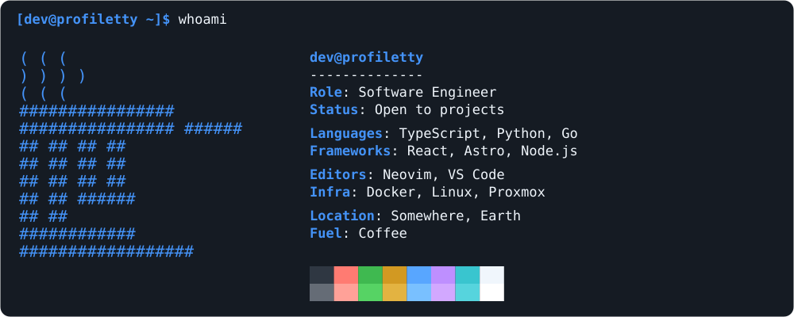</td>
    <td align="center"><b>github-light</b><br>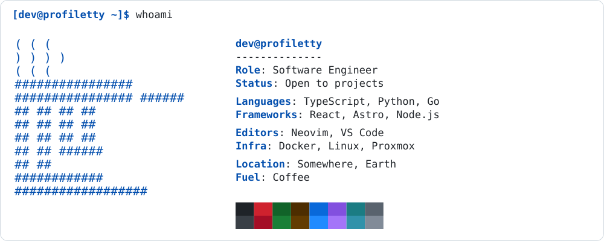</td>
    <td align="center"><b>dracula</b><br>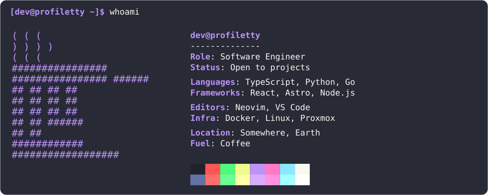</td>
  </tr>
  <tr>
    <td align="center"><b>tokyo-night</b><br>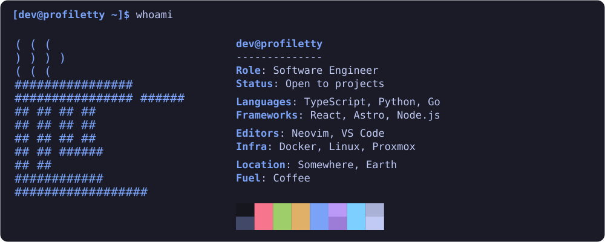</td>
    <td align="center"><b>tokyo-night-day</b><br>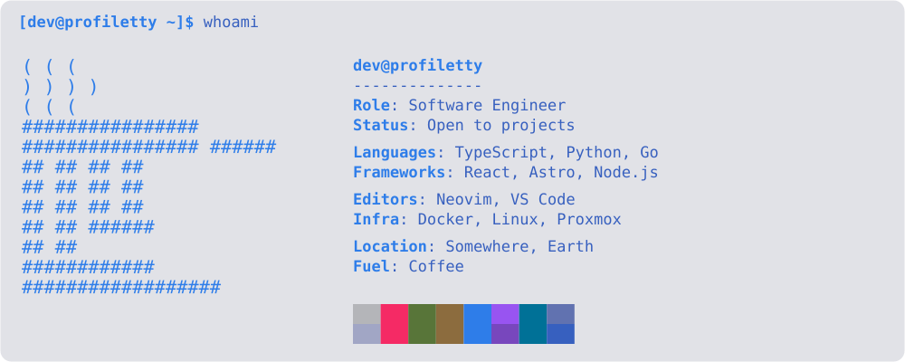</td>
    <td align="center"><b>nord</b><br>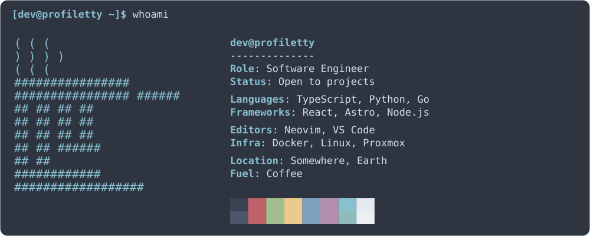</td>
  </tr>
  <tr>
    <td align="center"><b>monokai</b><br>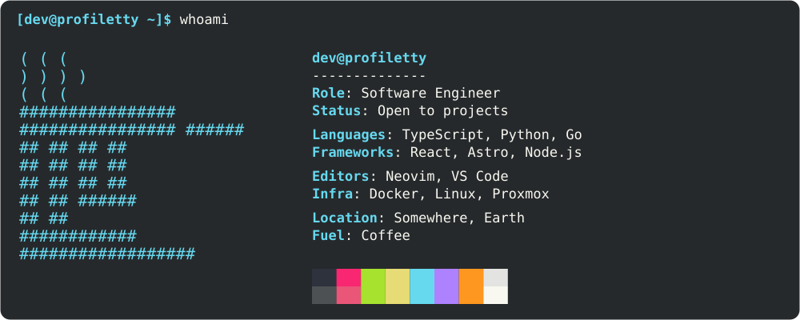</td>
    <td align="center"><b>catppuccin-mocha</b><br>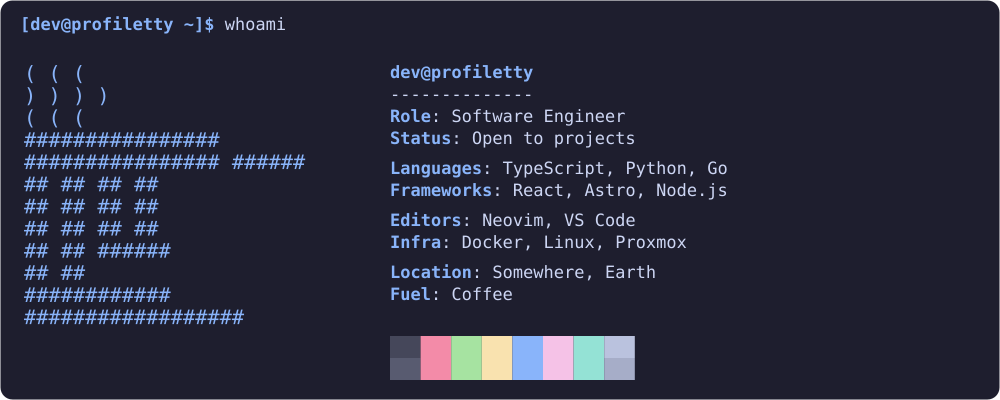</td>
    <td align="center"><b>catppuccin-latte</b><br>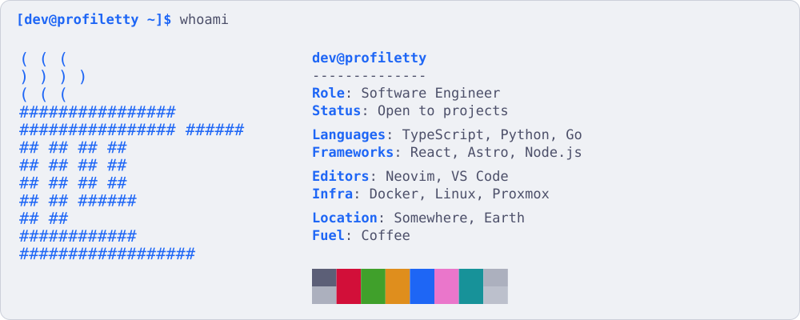</td>
  </tr>
  <tr>
    <td align="center"><b>gruvbox-dark</b><br>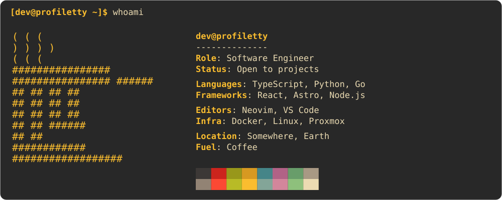</td>
    <td align="center"><b>gruvbox-light</b><br>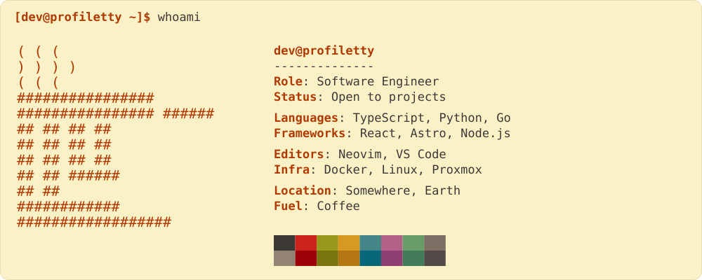</td>
    <td align="center"><b>rose-pine</b><br>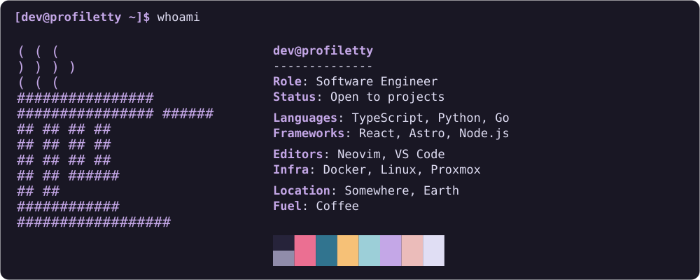</td>
  </tr>
  <tr>
    <td align="center"><b>rose-pine-dawn</b><br>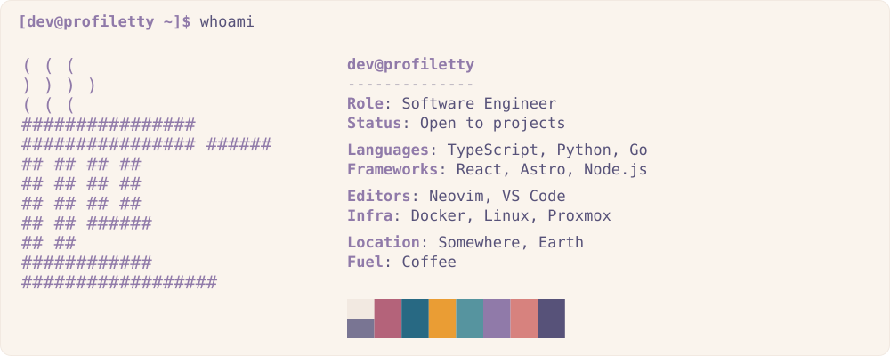</td>
    <td align="center"><b>one-dark</b><br>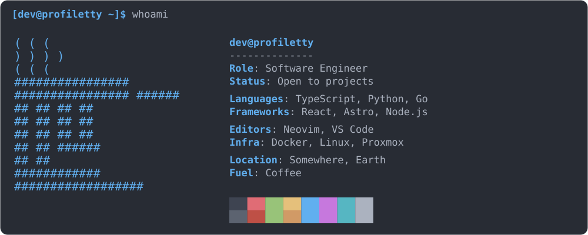</td>
    <td align="center"><b>kanagawa</b><br>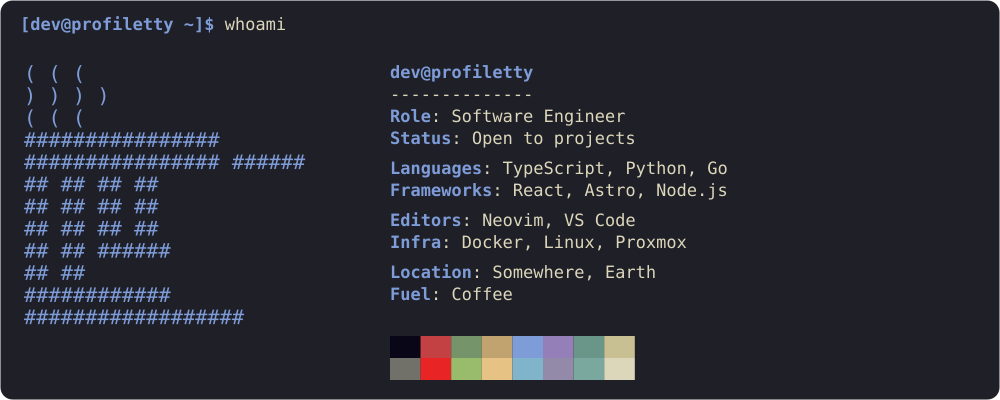</td>
  </tr>
  <tr>
    <td align="center"><b>everforest-dark</b><br>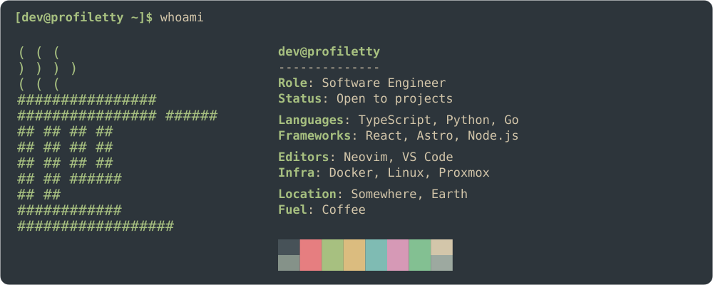</td>
    <td align="center"><b>everforest-light</b><br>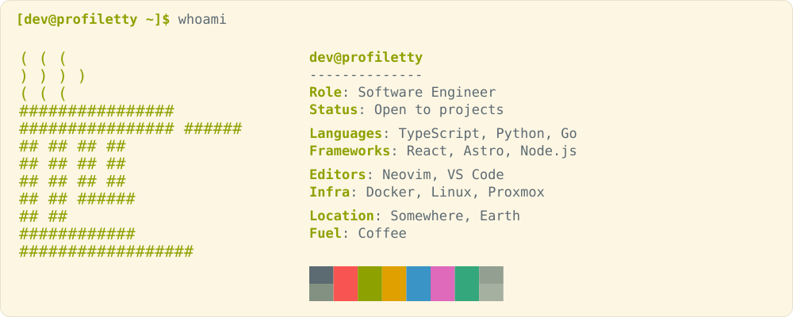</td>
    <td align="center"><b>night-owl</b><br>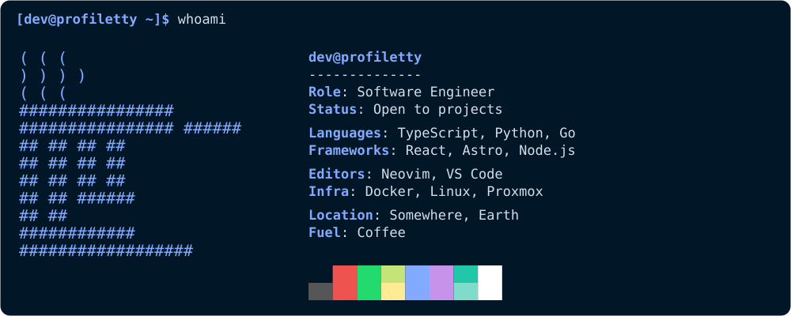</td>
  </tr>
  <tr>
    <td align="center"><b>solarized-dark</b><br>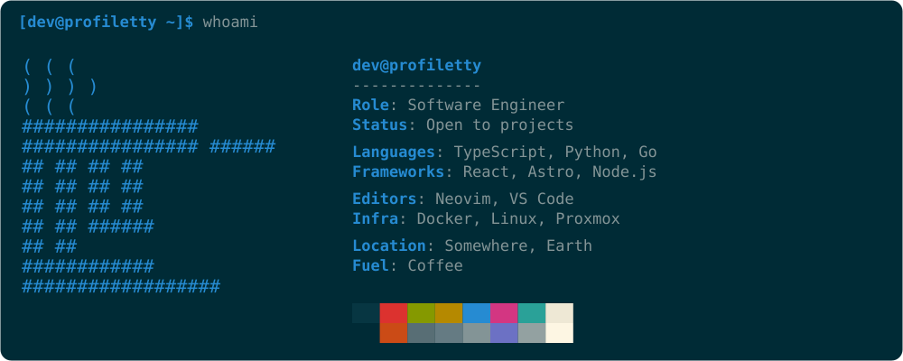</td>
    <td align="center"><b>solarized-light</b><br>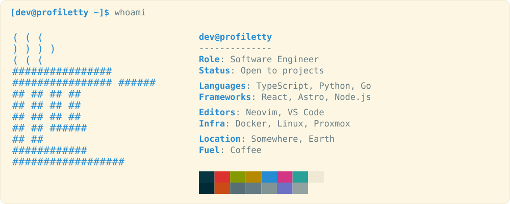</td>
    <td></td>
  </tr>
</table>

```json
{
  "theme": { "dark": "tokyo-night", "light": "tokyo-night-day" }
}
```

Cualquier preset funciona en ambos modos, así que `"dark": "solarized-light"` está permitido. Una tarjeta clara en una página oscura es decisión tuya.

Cambia colores sueltos con `colors`. Las claves permitidas son `bg`, `fg`, `dim`, `accent` y `border`. Usa valores `#rrggbb`, o `""` en `border` para quitar el borde. Los 16 bloques de la paleta vienen del preset.

```json
{
  "theme": { "dark": "dracula" },
  "colors": { "dark": { "accent": "#ff79c6" }, "light": { "border": "" } }
}
```

Mira todos los presets renderizados en [docs/THEMES.md](docs/THEMES.md).

Los colores de los presets vienen de los proyectos indicados en [THIRD_PARTY_NOTICES.md](THIRD_PARTY_NOTICES.md). No son temas oficiales de esos proyectos y ProfileTTY no está afiliado a ellos. En Solarized, dos bloques de la paleta tienen el mismo color que el fondo; así se define la paleta original.

## Crea tu arte ASCII

Usa un `.txt` de cualquier conversor o dibuja tu propio arte. ProfileTTY representa texto existente; no convierte imágenes. Sirven conversores como el [Image to ASCII de ASCII Art Archive](https://www.asciiart.eu/image-to-ascii); no son una dependencia de ejecución. Exporta el texto y conserva los espacios.

## Úsalo en GitHub

Copia el contenido de `dist/` a tu repositorio de perfil `USERNAME/USERNAME`, o primero a un repositorio de prueba. Mantén el README generado y los SVG en el mismo directorio para que funcionen las rutas relativas. Guarda una copia de tu README antes de sustituirlo. Añade tus enlaces debajo de la imagen.

El `<picture>` generado selecciona la imagen clara u oscura. El comportamiento final depende de GitHub y del entorno de visualización; comprueba ambos temas. En pantallas pequeñas la tarjeta se reduce junto con la página. Los enlaces dibujados dentro de la imagen no sustituyen los enlaces Markdown.

### Selección automática de tema

El README generado utiliza el soporte de GitHub para `<picture>` y selecciona un SVG claro u oscuro generado previamente según el tema de quien lo visualiza. No necesita JavaScript ni un servicio alojado. El SVG no cambia de color por sí mismo; el entorno de visualización elige qué imagen mostrar.

```html
<picture>
  <source media="(prefers-color-scheme: dark)" srcset="profile-dark.svg">
  
</picture>
```

No combines `prefers-color-scheme` con otras condiciones, como `max-width`, en el mismo `media`: GitHub reescribe las fuentes de tema para quien ha iniciado sesión y descarta la condición extra. Ajusta las rutas relativas según la ubicación de los SVG.

Consulta el [anuncio de GitHub sobre imágenes según el tema](https://github.blog/changelog/2022-05-19-specify-theme-context-for-images-in-markdown-beta/). Comprueba el resultado en GitHub en ambos temas.

### ¿Fork, clone o descarga?

- **Fork:** conserva tu copia en GitHub, personalízala y recibe mejoras del proyecto original.
- **Clone:** genera las imágenes localmente y copia solo el resultado a tu perfil.
- **Descargar ZIP:** obtén una copia local sin historial Git.

Para crear una tarjeta, clonar y copiar los archivos generados es lo más sencillo. Haz un fork si quieres mantener tu propia versión y recibir actualizaciones. El proyecto no es un paquete npm ni un servicio alojado.

## Desarrollo

```sh
npm test
npm run build
```

Las pruebas cubren validación (incluidos los mensajes de error), escape de XML, división de líneas, altura según el contenido y la CLI. Node elimina los tipos durante la ejecución; las pruebas no equivalen a una comprobación estática de tipos.

Consulta el flujo de contribución en [CONTRIBUTING.md](CONTRIBUTING.md), en inglés.

## Autor

Creado por [Carlos Kessler](https://github.com/KaduKessler).

## Licencia

El código y la documentación se distribuyen bajo la [licencia MIT](LICENSE).

Los avisos de terceros (Fira Code, colores de GitHub Primer) están en [THIRD_PARTY_NOTICES.md](THIRD_PARTY_NOTICES.md).
