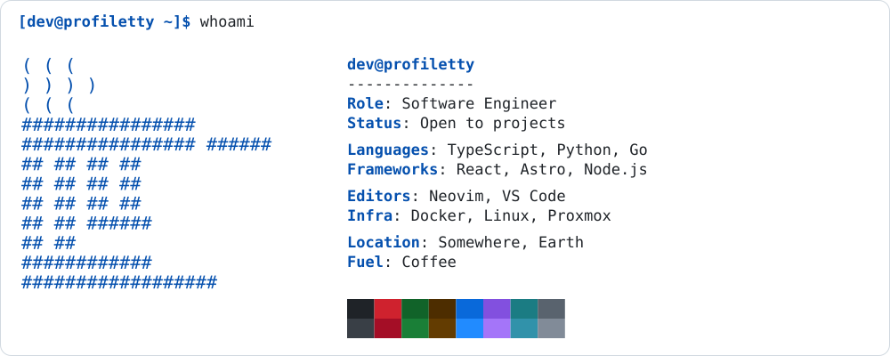
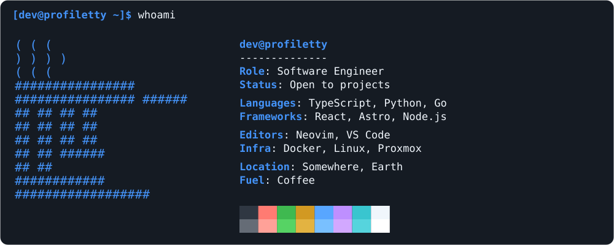
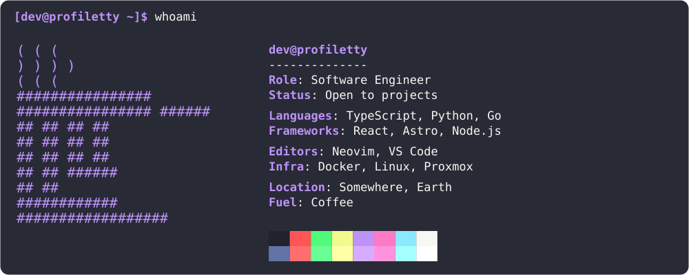
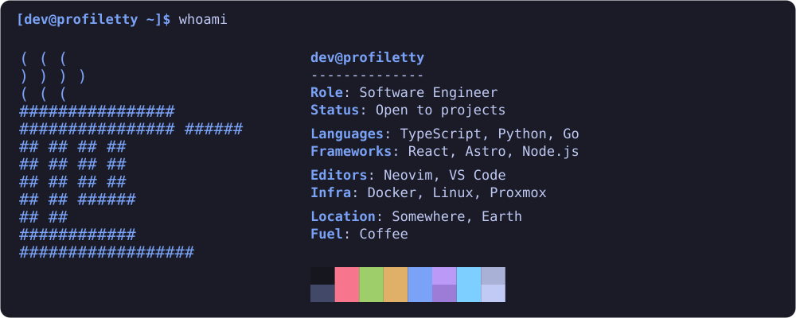
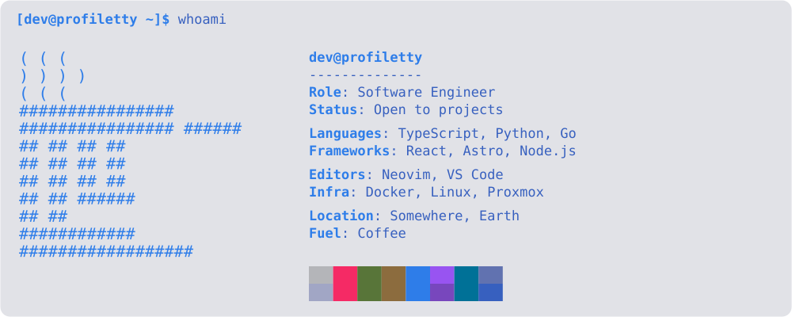
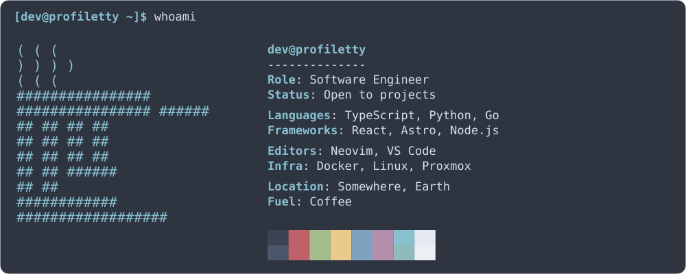
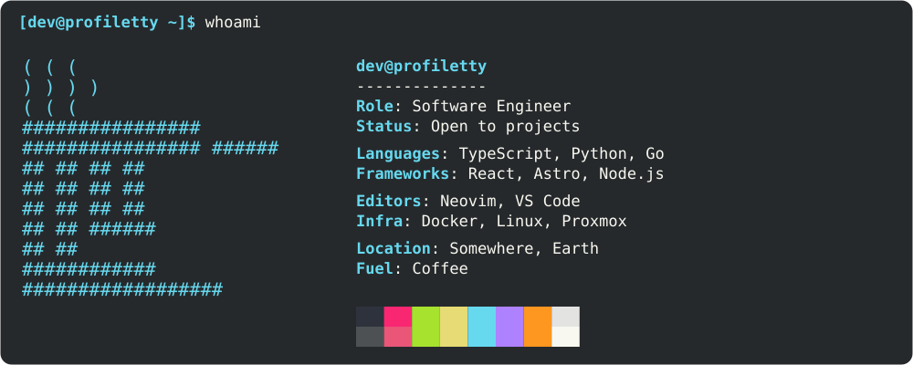
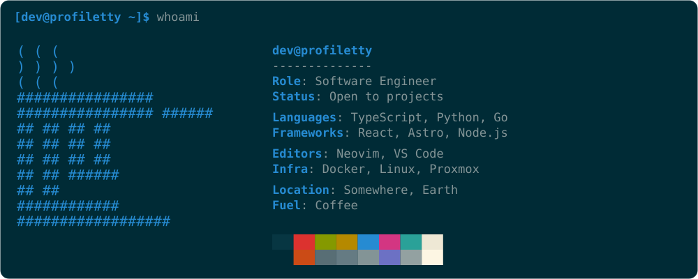
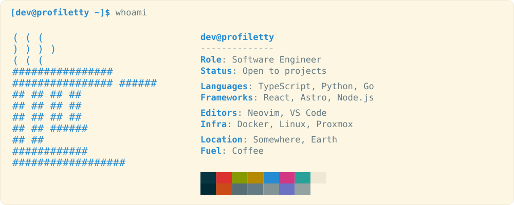

<div align="center">

# ProfileTTY

**Your identity, set in characters.**

Generate terminal-inspired GitHub profile cards from a local ASCII file and a small JSON configuration.

Node.js 24.12+ · TypeScript · No runtime dependencies · No hosted API

[English](README.md) · [Português](README.pt.md) · [Español](README.es.md)

</div>

<picture>
  <source media="(prefers-color-scheme: dark)" srcset="docs/profile-dark.svg">
  
</picture>

## A profile you can keep in your repository

ProfileTTY creates static SVGs. Your README does not need a server, API key, analytics service or external image generator. Configuration values are escaped for XML, long values wrap, and the card height follows the content.

- Light and dark artwork.
- A side-by-side terminal layout.
- Centered ASCII artwork with preserved spaces.
- Local JSON configuration with grouped fields.
- Accessible SVG titles and descriptions.

## Try it

Use **Node.js 26 LTS** for development. Node.js **24.12 or newer** is also supported. The generator uses native TypeScript execution; it does not compile or type-check with `tsc`.

```sh
git clone https://github.com/KaduKessler/profiletty.git
cd profiletty
npm test
npm run build
```

No `npm install` is needed.

The output is written to `dist/`:

```text
dist/
├── README.md
├── profile-dark.svg
└── profile-light.svg
```

## Make it yours

Copy `examples/profile.json` and replace the example information. Point `ascii` to your own text file; its path is resolved relative to the JSON file.

```json
{
  "heading": "yourname@github",
  "ascii": "logo.txt",
  "groups": [
    {
      "name": "Work",
      "fields": [
        { "label": "Build", "value": "What you make" }
      ]
    },
    {
      "name": "Environment",
      "fields": [
        { "label": "Editor", "value": "Your editor" }
      ]
    }
  ]
}
```

Generate a custom card with:

```sh
npm run card -- path/to/profile.json dist
```

| Setting | Accepted value |
| --- | --- |
| `heading` | Nonempty text, up to 40 characters |
| `ascii` | Local text-file path |
| `groups` | 1–8 groups |
| `groups[].name` | Nonempty text, up to 30 characters |
| `groups[].fields` | 1–12 label/value pairs |
| Field `label` | Nonempty, single-line text, up to 14 characters |
| Field `value` | Nonempty, single-line text, up to 240 characters |
| `palette` | Optional `true` (default) or `false` to hide the color blocks |
| `prompt` | Optional `true` (default) or `false` to hide the top prompt line |
| `leaders` | Optional `true` to draw dotted lines between labels and right-aligned values (default `false`) |
| `command` | Optional prompt command, up to 30 characters (default `profiletty`) |
| `theme` | Optional color preset for each mode, for example `{ "dark": "dracula", "light": "github-light" }`. See [Themes](#themes) |
| `colors` | Optional hex overrides for each mode, for example `{ "dark": { "accent": "#ff8800" } }`. See [Themes](#themes) |

ASCII artwork accepts printable ASCII characters, at most 180 columns and 100 rows. Preserve leading spaces and use spaces instead of tabs. Emoji and Unicode block drawings are not supported. Each SVG embeds a Fira Code subset, so glyph appearance does not depend on installed fonts.

## Themes

Each card has a dark and a light image. You choose a preset for each one with `theme`; the default is `github-dark` and `github-light`.

<table>
  <tr>
    <td align="center"><b>github-dark</b><br></td>
    <td align="center"><b>github-light</b><br></td>
  </tr>
  <tr>
    <td align="center"><b>dracula</b><br></td>
    <td align="center"><b>tokyo-night</b><br></td>
  </tr>
  <tr>
    <td align="center"><b>tokyo-night-day</b><br></td>
    <td align="center"><b>nord</b><br></td>
  </tr>
  <tr>
    <td align="center"><b>monokai</b><br></td>
    <td align="center"><b>solarized-dark</b><br></td>
  </tr>
  <tr>
    <td align="center"><b>solarized-light</b><br></td>
    <td></td>
  </tr>
</table>

```json
{
  "theme": { "dark": "tokyo-night", "light": "tokyo-night-day" }
}
```

Any preset works in either mode, so `"dark": "solarized-light"` is allowed. A card in a light preset on a dark page is your choice.

Override single colors with `colors`. Allowed keys are `bg`, `fg`, `dim`, `accent` and `border`. Use `#rrggbb` values, or `""` for `border` to remove the outline. The 16 palette blocks come from the preset.

```json
{
  "theme": { "dark": "dracula" },
  "colors": { "dark": { "accent": "#ff79c6" }, "light": { "border": "" } }
}
```

See every preset rendered in [docs/THEMES.md](docs/THEMES.md).

Preset colors come from the projects listed in [THIRD_PARTY_NOTICES.md](THIRD_PARTY_NOTICES.md). They are not official themes of those projects, and ProfileTTY is not affiliated with them. In Solarized, two palette blocks match the card background; that is how the original palette is defined.

## Create your ASCII artwork

Bring a `.txt` file from any converter or draw it yourself. ProfileTTY renders existing text; it does not convert images. Converters such as [ASCII Art Archive's Image to ASCII tool](https://www.asciiart.eu/image-to-ascii) work; they are not a runtime dependency. Export the ASCII as text and preserve its spacing.

## Use the result on GitHub

Copy the contents of `dist/` into your `USERNAME/USERNAME` profile repository, or into a test repository first. Keep the generated README and SVGs in the same directory so the relative image paths work. Back up your existing README before replacing it. Add your own clickable links below the image.

The generated `<picture>` selects the light or dark image. Final theme behavior is controlled by GitHub and the viewing environment; verify it on GitHub in both themes. On small screens the card scales down with the page. Links drawn inside SVG images are not a replacement for normal Markdown links.

### Automatic theme selection

The generated README uses GitHub's `<picture>` support to select a pre-generated light or dark SVG for the viewer's theme. No JavaScript or hosted service is required. The SVG itself does not change colors; the viewing environment selects which image to display.

```html
<picture>
  <source media="(prefers-color-scheme: dark)" srcset="profile-dark.svg">
  
</picture>
```

Do not combine `prefers-color-scheme` with other conditions such as `max-width` in one `media` attribute: GitHub rewrites theme sources for signed-in viewers and drops the extra condition. Keep the relative image paths aligned with where you store the SVGs.

See [GitHub's announcement of theme-aware images](https://github.blog/changelog/2022-05-19-specify-theme-context-for-images-in-markdown-beta/). Verify the result on GitHub in both themes.

### Fork, clone or download?

- **Fork** to keep your own GitHub copy, change the configuration and pull future upstream improvements.
- **Clone** to generate images locally. Only the generated output needs to go into your profile repository.
- **Download ZIP** if you want a one-time local copy without Git history.

For a one-time card, cloning and copying the generated files is the simplest workflow. Fork if you want to maintain your own version and receive upstream changes. It is not an npm package or a hosted service.

## Development

```sh
npm test
npm run build
```

Tests cover input validation (including error messages), XML escaping, wrapping, content-dependent height and the CLI. Node's TypeScript support removes types at runtime; passing tests is not a static type-check.

See [CONTRIBUTING.md](CONTRIBUTING.md) for the contribution workflow.

## Author

Created by [Carlos Kessler](https://github.com/KaduKessler).

## License

The source code and documentation are licensed under the [MIT License](LICENSE).

Third-party notices (Fira Code, GitHub Primer colors) are in [THIRD_PARTY_NOTICES.md](THIRD_PARTY_NOTICES.md).
