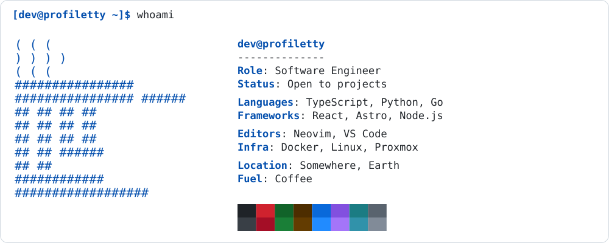
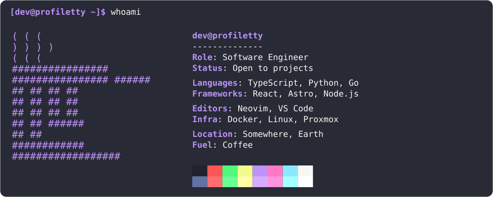
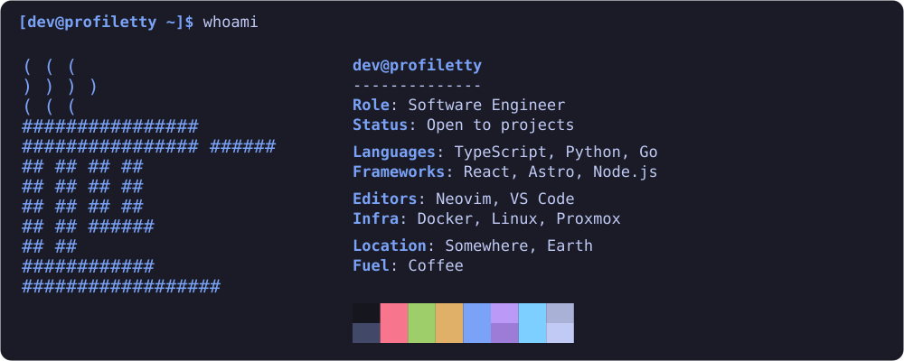
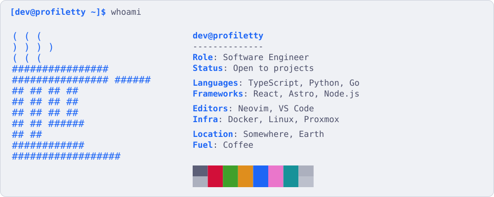

<div align="center">

# ProfileTTY

**Sua identidade, em caracteres.**

Cartões de perfil do GitHub com visual de terminal, gerados a partir de um arquivo ASCII e uma pequena configuração JSON.

[](https://github.com/KaduKessler/profiletty/actions/workflows/ci.yml)
[](LICENSE)


[Início rápido](#início-rápido) · [Configuração](#configuração) · [Temas](#temas) · [Use no GitHub](#use-no-github)

[English](README.md) · [Português](README.pt.md) · [Español](README.es.md)

<picture>
  <source media="(prefers-color-scheme: dark)" srcset="docs/profile-dark.svg">
  
</picture>

</div>

## Recursos

- **SVG estático.** Sem servidor, chave de API, análise de uso ou gerador hospedado. O cartão fica no seu repositório.
- **20 temas de cores.** Dracula, Nord, Tokyo Night, Catppuccin e outros, além de cores personalizadas.
- **Claro e escuro.** Um cartão por modo, escolhido automaticamente pelo GitHub.
- **Sua arte ASCII.** Qualquer arquivo de texto, com os espaços preservados.
- **Seguro e acessível.** Valores escapados para XML, textos longos quebram em linhas e cada SVG tem título e descrição.
- **Zero dependências.** TypeScript nativo no Node.js, com um subconjunto da Fira Code embutido em cada SVG.

## Início rápido

Requer **Node.js 24.12 ou superior** (26 LTS recomendado). Não é necessário `npm install`.

```sh
git clone https://github.com/KaduKessler/profiletty.git
cd profiletty
npm run build
```

Isso gera o cartão de exemplo em `dist/`:

```text
dist/
├── README.md
├── profile-dark.svg
└── profile-light.svg
```

Para personalizar, copie `examples/profile.json`, troque os dados e aponte `ascii` para seu arquivo de texto (caminho relativo ao JSON). As chaves do JSON permanecem em inglês; você pode traduzir os textos dos campos.

```sh
npm run card -- path/to/profile.json dist
```

## Configuração

```json
{
  "heading": "yourname@github",
  "ascii": "logo.txt",
  "groups": [
    {
      "name": "Work",
      "fields": [
        { "label": "Build", "value": "What you make" }
      ]
    },
    {
      "name": "Environment",
      "fields": [
        { "label": "Editor", "value": "Your editor" }
      ]
    }
  ]
}
```

| Configuração | Valor aceito |
| --- | --- |
| `heading` | Texto não vazio, até 40 caracteres |
| `ascii` | Caminho de um arquivo de texto local |
| `groups` | De 1 a 8 grupos |
| `groups[].name` | Texto não vazio, até 30 caracteres |
| `groups[].fields` | De 1 a 12 pares de rótulo e valor |
| `label` | Texto não vazio, em uma linha, até 14 caracteres |
| `value` | Texto não vazio, em uma linha, até 240 caracteres |
| `palette` | Opcional: `true` (padrão) ou `false` para ocultar os blocos de cor |
| `prompt` | Opcional: `true` (padrão) ou `false` para ocultar a linha de prompt no topo |
| `leaders` | Opcional: `true` para desenhar linhas de pontos entre o rótulo e o valor, alinhado à direita (padrão `false`) |
| `command` | Opcional: comando exibido no prompt, até 30 caracteres (padrão `profiletty`) |
| `theme` | Preset de cores opcional para cada modo, por exemplo `{ "dark": "dracula", "light": "github-light" }`. Veja [Temas](#temas) |
| `colors` | Substituições opcionais em hexadecimal para cada modo, por exemplo `{ "dark": { "accent": "#ff8800" } }`. Veja [Temas](#temas) |

### Arte ASCII

Use um `.txt` de qualquer conversor, como o [Image to ASCII do ASCII Art Archive](https://www.asciiart.eu/image-to-ascii), ou desenhe sua arte. O ProfileTTY renderiza texto existente; não converte imagens. Use ASCII imprimível, até 180 colunas e 100 linhas, com espaços em vez de tabulações. Emojis e desenhos com blocos Unicode não são aceitos.

## Temas

Escolha um preset para cada modo com `theme`. O padrão é `github-dark` e `github-light`.

<table>
  <tr>
    <td align="center"><b>dracula</b><br></td>
    <td align="center"><b>tokyo-night</b><br></td>
    <td align="center"><b>catppuccin-latte</b><br></td>
  </tr>
</table>

Os 20 presets estão na **[galeria de temas](docs/THEMES.md)**.

```json
{
  "theme": { "dark": "tokyo-night", "light": "tokyo-night-day" }
}
```

Qualquer preset funciona nos dois modos. Troque cores avulsas com `colors`: as chaves aceitas são `bg`, `fg`, `dim`, `accent` e `border`, em valores `#rrggbb` (ou `""` em `border` para tirar a borda). Os 16 blocos da paleta vêm do preset.

```json
{
  "theme": { "dark": "dracula" },
  "colors": { "dark": { "accent": "#ff79c6" }, "light": { "border": "" } }
}
```

As cores dos presets vêm dos projetos listados em [THIRD_PARTY_NOTICES.md](THIRD_PARTY_NOTICES.md). Não são temas oficiais desses projetos, e o ProfileTTY não é afiliado a eles. No Solarized, dois blocos da paleta têm a mesma cor do fundo; é assim que a paleta original é definida.

## Use no GitHub

Copie o conteúdo de `dist/` para seu repositório de perfil `USERNAME/USERNAME` (ou primeiro para um repositório de teste), mantendo o README e os SVGs na mesma pasta. Faça uma cópia do README atual antes de substituí-lo e adicione seus links abaixo da imagem.

O README gerado escolhe o SVG claro ou escuro com o suporte do GitHub a `<picture>`. Não há JavaScript nem serviço hospedado:

```html
<picture>
  <source media="(prefers-color-scheme: dark)" srcset="profile-dark.svg">
  
</picture>
```

Não combine `prefers-color-scheme` com outras condições, como `max-width`, no mesmo `media`: o GitHub reescreve as fontes de tema para quem está logado e descarta a condição extra. Links desenhados dentro de um SVG não substituem links Markdown. Confira o resultado no GitHub nos dois temas. Veja o [anúncio do GitHub sobre imagens conforme o tema](https://github.blog/changelog/2022-05-19-specify-theme-context-for-images-in-markdown-beta/).

Clone para gerar localmente e copie só a saída para seu perfil. Faça um fork se quiser manter uma versão própria e receber atualizações. O projeto não é um pacote npm nem um serviço hospedado.

## Desenvolvimento

```sh
npm test
npm run build
npm run docs   # regenera docs/ (o CI falha se estiverem desatualizados)
```

Os testes cobrem validação (incluindo mensagens de erro), escape de XML, quebra de linhas, altura conforme o conteúdo, temas e a CLI. O Node remove os tipos na execução; os testes não equivalem a uma verificação estática de tipos. Veja [CONTRIBUTING.md](CONTRIBUTING.md), em inglês.

## Autor e licença

Criado por [Carlos Kessler](https://github.com/KaduKessler). Código e documentação sob a [licença MIT](LICENSE). Os avisos de terceiros (Fira Code, cores do GitHub Primer, temas de cores) estão em [THIRD_PARTY_NOTICES.md](THIRD_PARTY_NOTICES.md).
