# Themes

Every preset, rendered with the example profile. Pick one per mode with `theme`; see the [README](../README.md#themes) for the full options.

Regenerate this page with `npm run docs`.

## github-dark

```json
{ "theme": { "dark": "github-dark" } }
```

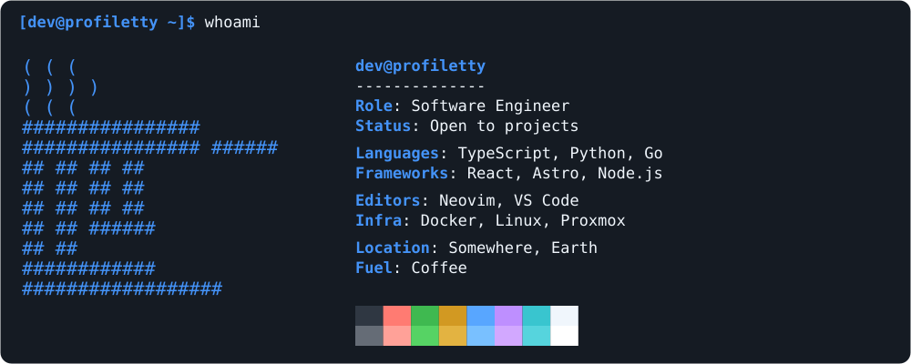

## github-light

```json
{ "theme": { "dark": "github-light" } }
```

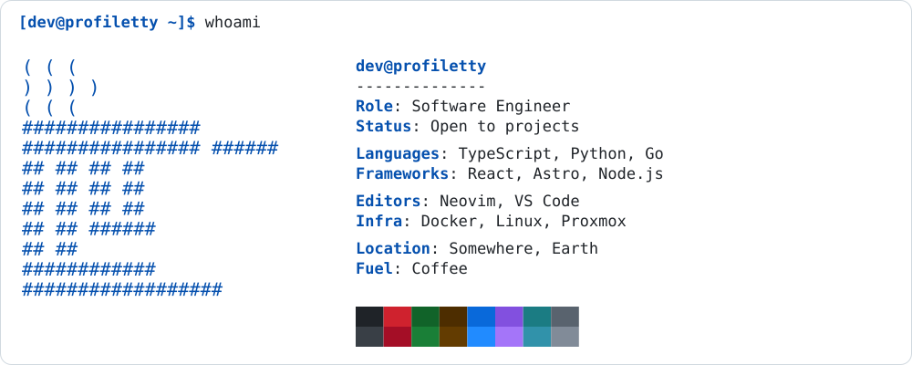

## dracula

```json
{ "theme": { "dark": "dracula" } }
```

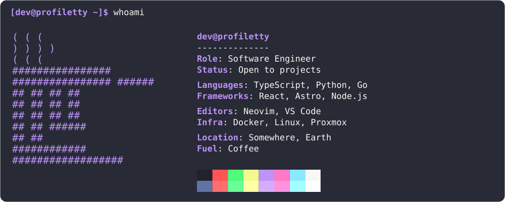

## tokyo-night

```json
{ "theme": { "dark": "tokyo-night" } }
```

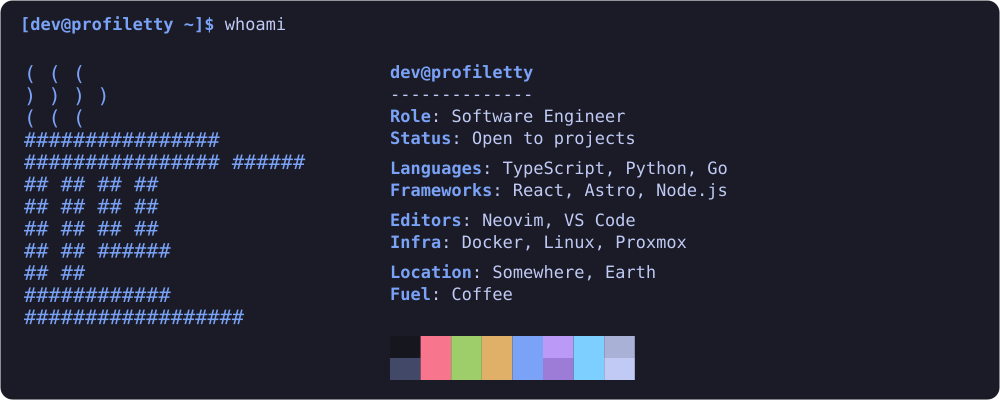

## tokyo-night-day

```json
{ "theme": { "dark": "tokyo-night-day" } }
```

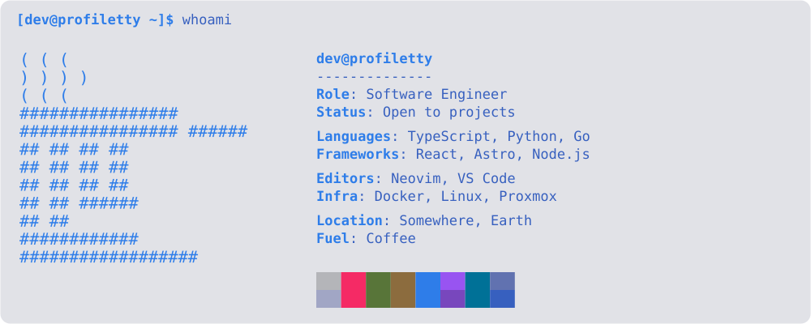

## nord

```json
{ "theme": { "dark": "nord" } }
```

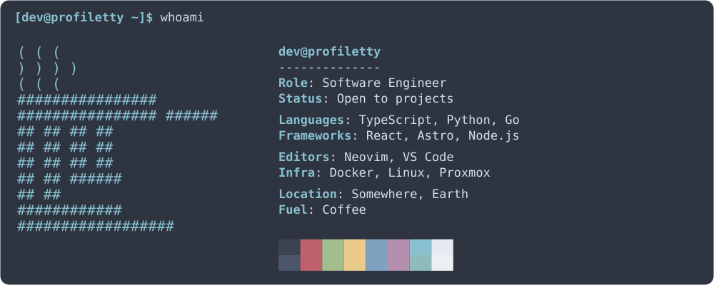

## monokai

```json
{ "theme": { "dark": "monokai" } }
```

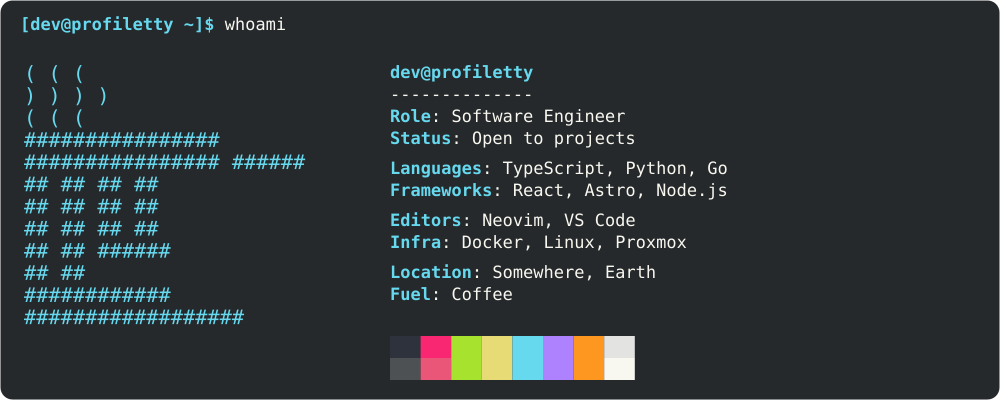

## catppuccin-mocha

```json
{ "theme": { "dark": "catppuccin-mocha" } }
```

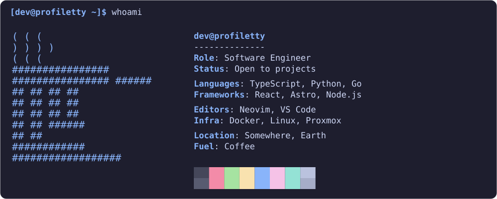

## catppuccin-latte

```json
{ "theme": { "dark": "catppuccin-latte" } }
```

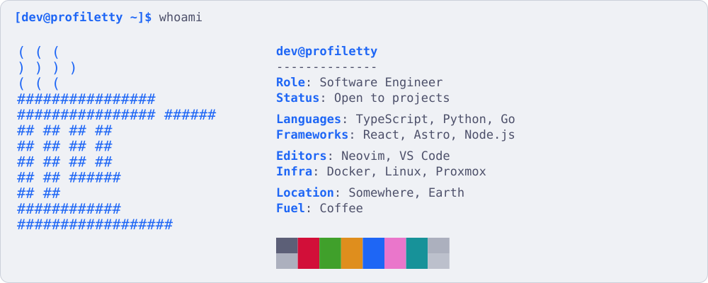

## gruvbox-dark

```json
{ "theme": { "dark": "gruvbox-dark" } }
```

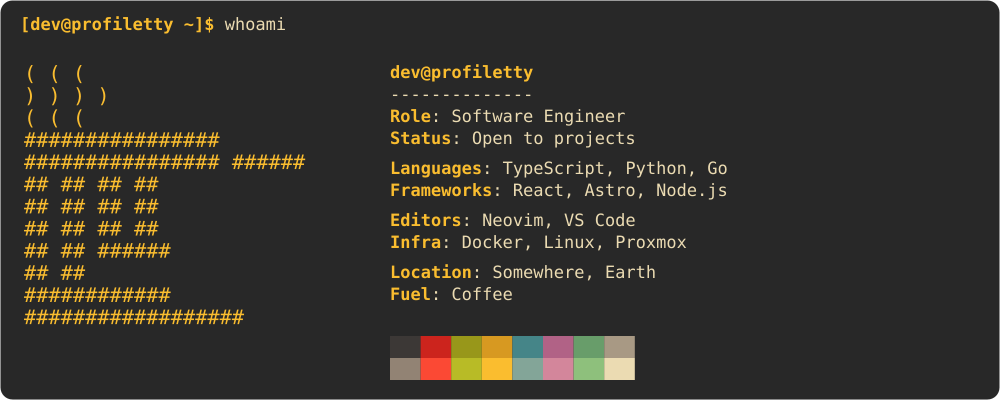

## gruvbox-light

```json
{ "theme": { "dark": "gruvbox-light" } }
```

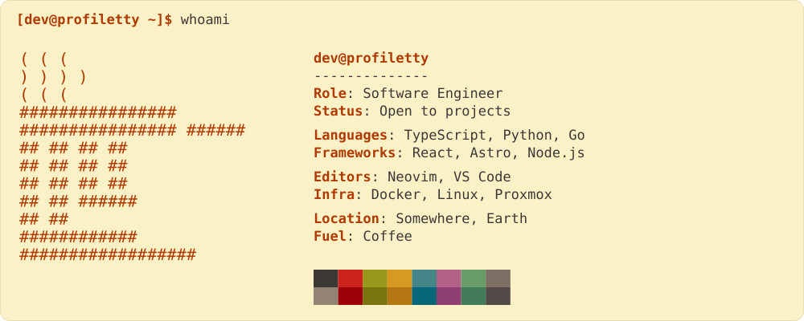

## rose-pine

```json
{ "theme": { "dark": "rose-pine" } }
```

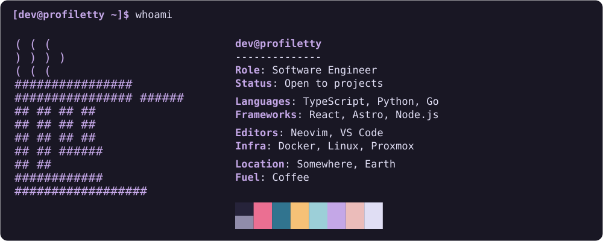

## rose-pine-dawn

```json
{ "theme": { "dark": "rose-pine-dawn" } }
```

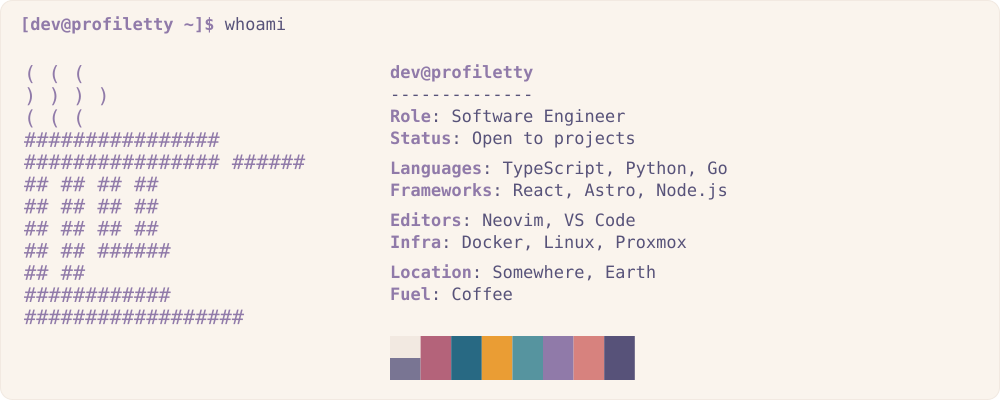

## one-dark

```json
{ "theme": { "dark": "one-dark" } }
```

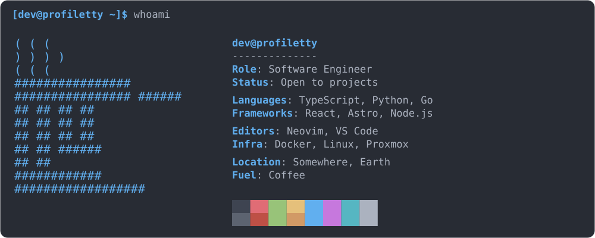

## kanagawa

```json
{ "theme": { "dark": "kanagawa" } }
```

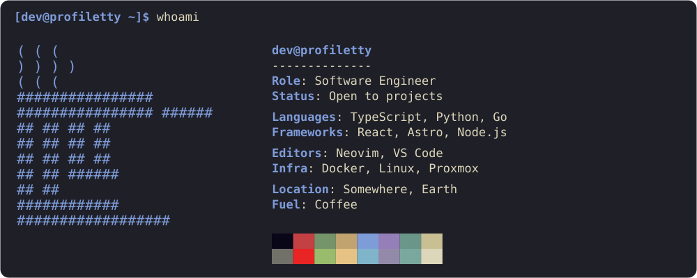

## everforest-dark

```json
{ "theme": { "dark": "everforest-dark" } }
```

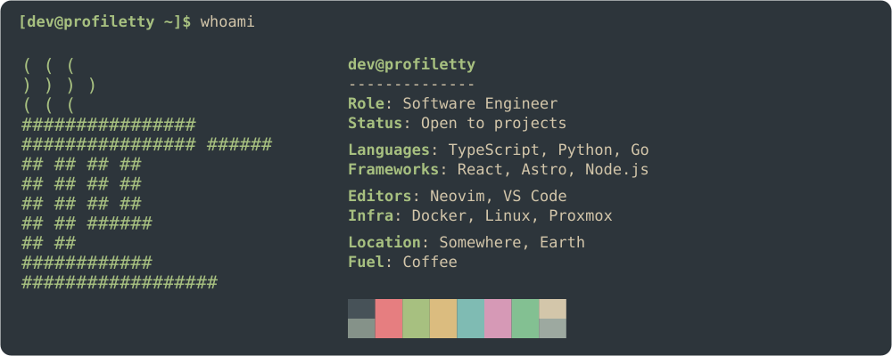

## everforest-light

```json
{ "theme": { "dark": "everforest-light" } }
```

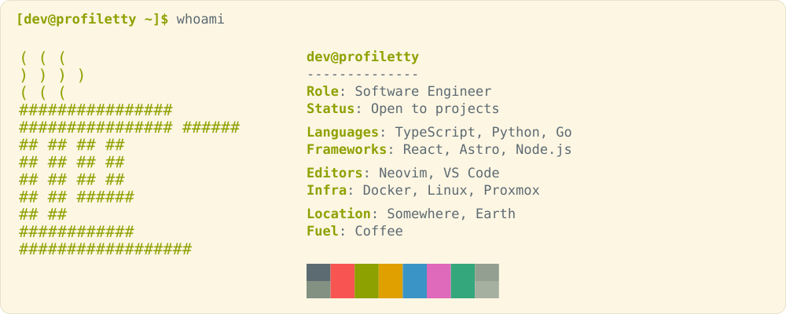

## night-owl

```json
{ "theme": { "dark": "night-owl" } }
```

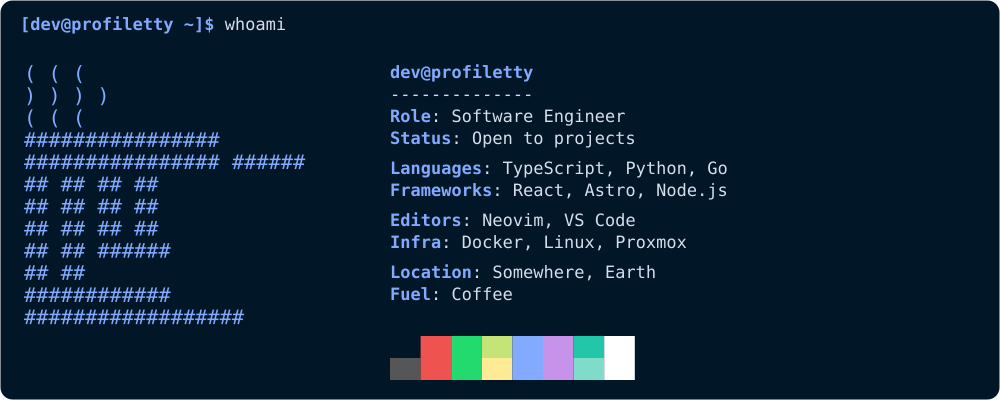

## solarized-dark

```json
{ "theme": { "dark": "solarized-dark" } }
```

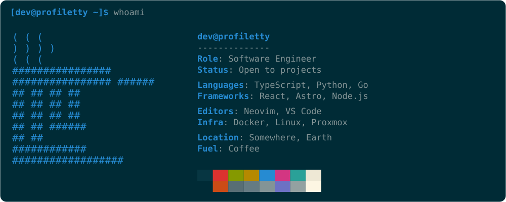

## solarized-light

```json
{ "theme": { "dark": "solarized-light" } }
```

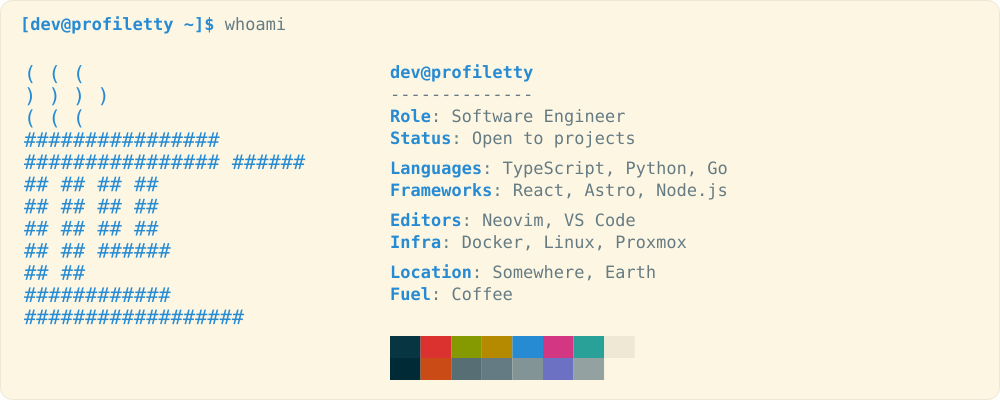
